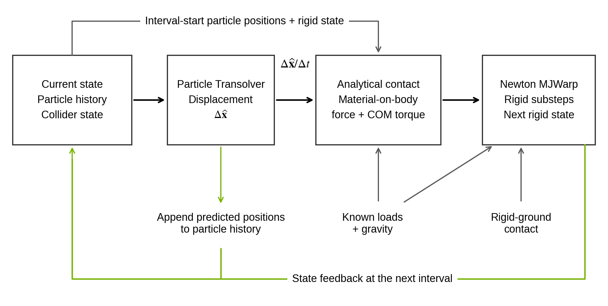
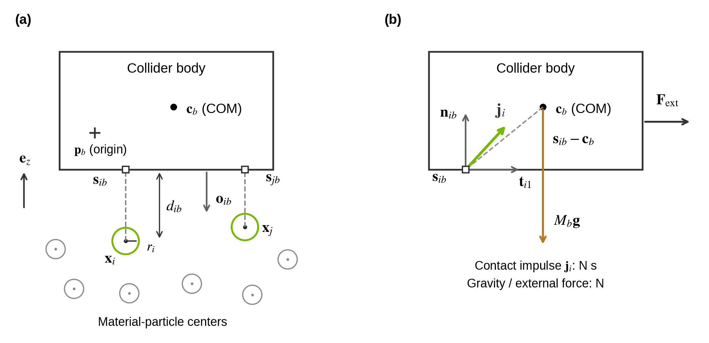
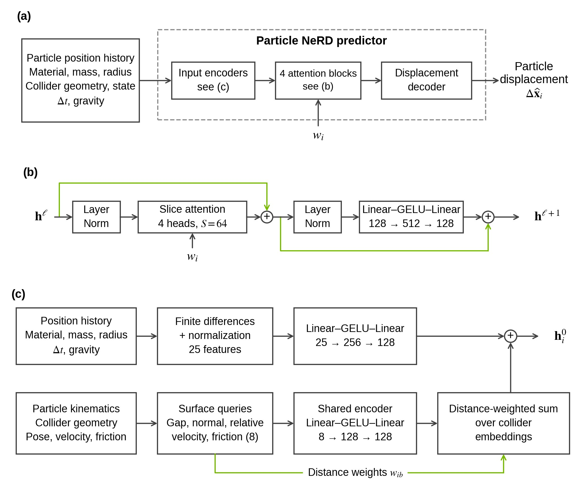
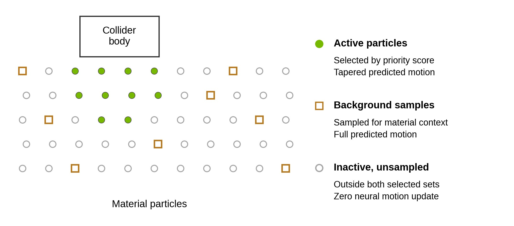
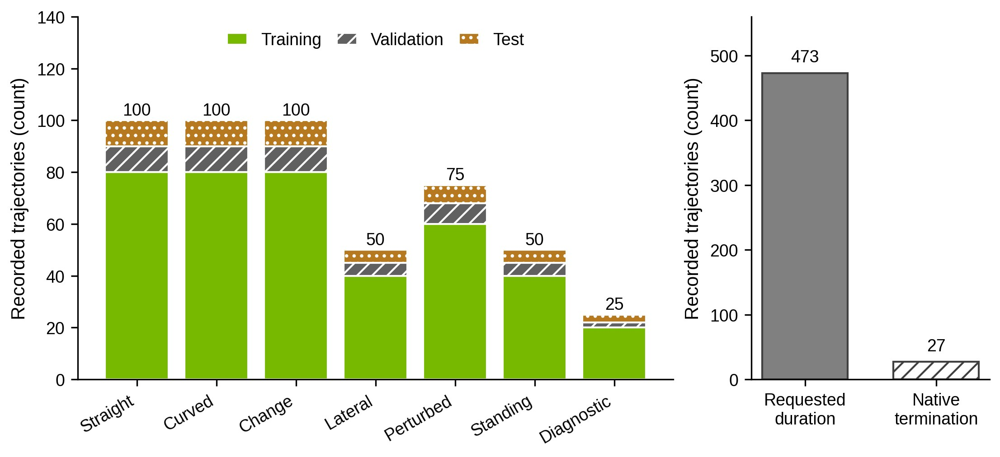

.. _particle-nerd-methodology:

Particle NeRD: learned particle dynamics with analytical rigid-body coupling
============================================================================

Abstract
--------

Particle NeRD represents deformable material by persistent particles and replaces
its numerical material update with a learned displacement operator. A
collider-conditioned Transolver maps particle position histories, material
parameters, and rigid-surface kinematics to particle displacements. An analytical
contact model then reconstructs the force and torque exerted by the material on
each supported rigid-body proxy. Newton MJWarp advances the rigid dynamics under
these loads. This decomposition retains a conventional rigid-body solver while
learning material motion from coupled material point method (MPM) simulations.
An optional active-particle approximation evaluates the
network on particles near interaction regions and a weighted sample of the
remaining material. This article specifies the representations, training losses,
contact equations, and execution order of the implementation. It also identifies
approximations that require separate validation: displacement-derived velocity,
empirical contact mobility, incomplete material state, and selective particle
updates.

.. note::

   **Scope and version.** This is methodology documentation, not a completed
   experimental paper. Equations are grounded in source revision
   ``d5cc675f5a9a1af39fc4d86f47da5861f2be3711``. The accompanying
   `explanation slides <https://github.com/jnskkmhr/particle-nerd-plan/tree/84e2fda35d79ccbd9fd86d8cd65995ebf95150f6>`_
   provide context. Where slides, historical READMEs, and executable code differ,
   this article follows the executable code at that revision. Subsequent local
   implementation edits are outside this snapshot. No new simulation or training
   results are claimed here.

Problem formulation and method overview
---------------------------------------

We consider a material bed interacting with dynamic collider bodies.
The reference simulator evolves material particles using MPM and rigid bodies
using MJWarp. The learned simulator retains particle identities and the rigid
solver, but predicts material motion from a finite position history. This allows
material evolution and rigid-body response to be evaluated by different models.

Let :math:`\mathbf{x}_i^n\in\mathbb{R}^3` denote the position of material particle
:math:`i` at time :math:`t_n`, and let :math:`\Delta t` be the particle prediction
interval. The network input contains
:math:`\mathcal{H}_i^n=(\mathbf{x}_i^{n-H+1},\ldots,\mathbf{x}_i^n)`, usually with
:math:`H=3`. Collider :math:`b` has pose :math:`T_b^n`, linear velocity
:math:`\mathbf{v}_{p,b}^n` at its geometry origin, angular velocity
:math:`\boldsymbol\omega_b^n`, and friction coefficient :math:`\mu_b`.
All vectors are expressed in world-aligned axes. Positions may be translated
by the environment origin before feature construction; such a translation does
not rotate vectors into a collider-body frame. The generic formulation below
describes one dynamic collider body, with multiple bodies represented by their
collider geometries and a specified rigid-body response model.

.. list-table:: Notation and measurement references
   :header-rows: 1
   :widths: 22 56 22

   * - Symbol
     - Meaning
     - Unit
   * - :math:`N,H,B`
     - Number of particles, history frames, and colliders
     - Counts
   * - :math:`d_{ib},\mathbf{o}_{ib}`
     - Signed distance from particle center to collider surface; outward collider normal
     - m; dimensionless
   * - :math:`\mathbf{s}_{ib},\mathbf{c}_b`
     - Closest collider surface point; rigid-body center of mass (COM)
     - m
   * - :math:`\widehat{\mathbf{u}}_i^{n+1}`
     - Predicted particle displacement divided by :math:`\Delta t`
     - m/s
   * - :math:`m_i,w_i`
     - Physical particle mass; background representation weight
     - kg; dimensionless
   * - :math:`\mathbf{j}_i,\mathbf{F},\boldsymbol\tau`
     - Material-on-body impulse, force, and torque about the body COM
     - N s; N; N m

   **Figure 1:** Particle NeRD coupling for a dynamic collider body. Solid arrows show
   within-step dependencies; the lower path feeds the updated rigid state into
   the next step. Contact geometry uses interval-start particle positions, while
   material velocities come from the predicted displacements. Known external loads and gravity enter both the free-motion estimate
   and rigid integration; rigid-ground contacts are resolved by MJWarp. The material
   wrench is held during rigid substeps. This is an authored schematic, not a
   measured trajectory.

The method has three functional components. The particle network estimates
material kinematics. The contact estimator converts these kinematics into a
material-on-body wrench. The rigid solver applies that wrench along with gravity,
actuation, prescribed external loads, and rigid contacts. The estimator's
auxiliary material response is internal to the contact calculation: it does not
apply a second impulse update to the predicted particles. Consequently, momentum
conservation of the combined learned system does not follow from rigid momentum
balance alone.

.. list-table:: Algorithm 1. One coupled Particle NeRD prediction interval
   :header-rows: 1
   :widths: 8 50 42

   * - Step
     - Operation
     - Output and state ownership
   * - Input
     - Particle history :math:`\mathcal{H}^n`; current collider pose and velocity;
       material features; masses/inertias; geometry; external loads; :math:`\Delta t`.
     - Network parameters are fixed during inference. No future reference states
       are inputs.
   * - 1
     - Save :math:`\mathbf{x}^n`. Optionally rank particles, select :math:`K`
       active samples and :math:`M` background samples, and assign weights :math:`w_i`.
     - Retain the full particle state; construct the neural evaluation subset.
   * - 2
     - Query each sampled particle against collider geometry. Encode particle
       histories and weighted collider features; evaluate slice attention.
     - Predicted displacements :math:`\Delta\widehat{\mathbf{x}}`.
   * - 3
     - In compact mode, taper active displacements and scatter active/background
       updates. Apply any explicitly configured boundary corrections.
     - :math:`\widehat{\mathbf{x}}^{n+1}` and
       :math:`\widehat{\mathbf{u}}^{n+1}=(\widehat{\mathbf{x}}^{n+1}-\mathbf{x}^n)/\Delta t`.
       Append positions to particle history.
   * - 4
     - Form the free collider velocity under known loads. At saved positions
       :math:`\mathbf{x}^n`, extrapolate material velocities to collider surfaces;
       identify candidate contacts using free collider motion.
     - Free collider velocity, material surface velocities, contact frames,
       signed gaps, and moment arms.
   * - 5
     - Choose material mobilities and solve contact impulses together with
       collider momentum balance.
     - Material-on-body force and COM torque. Do not apply the auxiliary
       material impulse response to the predicted particles a second time.
   * - 6
     - Advance the rigid-body solver under the held material wrench, gravity,
       known external loads, and rigid contacts over the substeps of :math:`\Delta t`.
     - Updated collider pose and velocity for the next prediction interval.

The neural prediction in steps 2--3 and the contact solve in step 5 have different
unknowns. The network predicts particle displacement. The contact solve finds
impulses that make an auxiliary material response and the collider-body response
compatible. The rigid-body solver then performs the actual state integration.

Collider-conditioned particle dynamics
---------------------------------------

Particle and geometry features
~~~~~~~~~~~~~~~~~~~~~~~~~~~~~~

The network represents each material particle by its current position, recent
motion, and material context. For :math:`H=3`, the particle feature vector has 25
components: position relative to a configured origin (3), two finite-difference
velocities (6), ten normalized material parameters (10), particle mass and radius
(2), prediction interval (1), and gravity (3). Positions use a 1 m reference scale,
velocities a 1 m/s scale, and gravity a 9.81 m/s\ :sup:`2` scale. The timestep
feature is :math:`\Delta t/(0.02\,\mathrm{s})`.

The material parameters are density, Young's modulus, Poisson ratio, friction,
yield pressure, tensile yield ratio, yield stress, hardening, dilatancy, and
viscosity. The implementation uses explicit linear or logarithmic normalizations
in ``material_features``. The current readers broadcast one material vector,
particle mass, and particle radius across an example. Providing these quantities makes material variation
representable at the input; it does not establish generalization to unseen
materials. Stress, plastic strain, and deformation-gradient histories are not
network inputs. A short position history is therefore an approximate state for a
history-dependent material.

Collider conditioning uses a particle-specific point on the collider surface,
not the collider's base position. Three points must be distinguished:
:math:`\mathbf{p}_b` is the origin of the collider geometry's pose,
:math:`\mathbf{c}_b` is the collider body's center of mass, and
:math:`\mathbf{s}_{ib}` is the surface point queried for particle
:math:`\mathbf{x}_i^n`. The origin and COM can coincide for some assets but need
not do so. In contrast, :math:`\mathbf{s}_{ib}` changes with the particle and
collider pose; different particles generally query different surface points.

Let :math:`\phi_b` be the signed distance to the collider boundary, positive
outside the rigid volume. At a smooth point of an exact signed-distance field,
its outward unit normal is :math:`\mathbf{o}_{ib}=\nabla\phi_b(\mathbf{x}_i^n)`.
The geometry query returns

.. math::

   d_{ib}=\phi_b(\mathbf{x}_i^n),\qquad
   \mathbf{s}_{ib}=\mathbf{x}_i^n-d_{ib}\mathbf{o}_{ib},\qquad
   g_{ib}=d_{ib}-r_i.

For an exterior particle, :math:`\mathbf{s}_{ib}` is the closest boundary point
of the collider, and :math:`d_{ib}` is the center-to-surface distance. Subtracting
particle radius :math:`r_i` gives the neural feature gap :math:`g_{ib}`. Inside
the collider, :math:`d_{ib}<0` and the projection points toward the nearest
boundary. At edges or other nonunique projections, the geometry query chooses
one normal; a sampled SDF yields an approximate projection. For a sphere, the
query point lies on the radial line from its center; for an exterior point
beside a flat box face, it is the perpendicular projection onto that face.

   **Figure 2:** Collider-surface queries and load references in a two-dimensional
   cross-section. **(a)** Particle-specific geometry queries: open squares mark
   collider surface points :math:`\mathbf{s}_{ib}`; circles mark material
   particles with centers :math:`\mathbf{x}_i`. The geometry origin
   :math:`\mathbf{p}_b` and COM :math:`\mathbf{c}_b` are distinct fixed body
   points. The center-to-surface distance is :math:`d_{ib}`, particle radius is
   :math:`r_i`, and :math:`\mathbf{o}_{ib}` is the outward collider normal.
   **(b)** Free-body sketch: the isolated collider receives a material-on-body
   impulse :math:`\mathbf{j}_i`, gravity :math:`M_b\mathbf{g}`, and a known
   external force :math:`\mathbf{F}_{\rm ext}`. The compressive normal is
   :math:`\mathbf{n}_{ib}=-\mathbf{o}_{ib}`; :math:`\mathbf{t}_{i1}` is a
   tangent direction. Torque is computed about the COM using the moment arm
   :math:`\mathbf{s}_{ib}-\mathbf{c}_b`. Geometry and arrows are schematic,
   not measured loads; the third dimension and other contacts are omitted.

A surface query is a potential interaction location, not proof of an active
collision. The network queries geometry even for separated particles within
its feature-support distance. The analytical estimator later decides whether
a query is a contact candidate and whether it carries a nonzero impulse.
Thus these points are neither one fixed point per collider nor a list of
contacts supplied by the rigid-body collision solver.

The collider surface velocity includes translation and rotation about a
specified reference point:

.. math::

   \mathbf{u}_{b}(\mathbf{s}_{ib})=
   \mathbf{v}_{p,b}^n+\boldsymbol\omega_b^n\times(\mathbf{s}_{ib}-\mathbf{p}_b)
   =\mathbf{V}_b^n+\boldsymbol\omega_b^n\times(\mathbf{s}_{ib}-\mathbf{c}_b).

Here :math:`\mathbf{v}_{p,b}^n` is linear velocity at the geometry origin and
:math:`\mathbf{V}_b^n` is COM linear velocity. They are related by
:math:`\mathbf{v}_{p,b}^n=\mathbf{V}_b^n+
\boldsymbol\omega_b^n\times(\mathbf{p}_b-\mathbf{c}_b)`.
The network interface uses the origin-based form; the force estimator uses
COM moment arms. Mixing one point's linear velocity with the other point's
moment arm would give the wrong surface velocity.

For support length :math:`R=0.07\,\mathrm{m}`, the eight pair features and their
influence weight are

.. math::

   \mathbf{c}_{ib}=\left[
   \operatorname{clip}(g_{ib}/R,-1,1),\ \mathbf{o}_{ib},\
   \frac{\mathbf{u}_{b}(\mathbf{s}_{ib})-
   (\mathbf{x}_i^n-\mathbf{x}_i^{n-1})/\Delta t}{1\,\mathrm{m/s}},\ \mu_b\right],

.. math::

   w_{ib}=\max\left(0,1-\frac{\max(g_{ib},0)}{R}\right).

A shared collider encoder embeds each pair and sums its weighted contribution
into the particle token:

.. math::

   \mathbf{h}_i^0=E_p(\mathbf{f}_i)+\sum_{b=1}^{B}w_{ib}E_c(\mathbf{c}_{ib}).

This sum permits simultaneous contributions from several nearby colliders and
is invariant to collider order, up to floating-point reduction differences.
Distant colliders have zero direct influence, but attention can propagate their
effects through other particles. The implemented feature queries include analytic primitives and sampled signed-distance fields. A new collider
geometry must provide consistent distance, outward normal, and surface-point
queries; the interface alone does not validate an arbitrary mesh asset.

Slice attention and displacement prediction
~~~~~~~~~~~~~~~~~~~~~~~~~~~~~~~~~~~~~~~~~~~~

   **Figure 3:** Hierarchical architecture of the Particle NeRD particle predictor.
   **(a)** System inputs and output: particle position histories, material properties,
   collider geometry and state, timestep, and gravity pass through the input
   encoders, four attention blocks, and a displacement decoder. Representation
   weights :math:`w_i` enter the attention blocks. The output is one predicted
   displacement per evaluated particle. The encoder and block modules are expanded
   in (c) and (b), respectively. **(b)** One attention block: LayerNorm precedes
   multi-head slice attention and a residual addition; a second LayerNorm and
   Linear--GELU--Linear MLP are followed by another residual addition. Green paths
   carry the residual connections. **(c)** Input processing: particle position
   history provides the current position and finite-difference velocities, combined
   with normalized material properties, mass, radius, timestep, and gravity into
   25 features. Particle--collider surface queries provide eight pair features:
   normalized gap, outward normal, relative surface velocity, and friction.
   Separate Linear--GELU--Linear encoders produce particle and collider-pair
   embeddings. The shared collider encoder is applied to every pair, and its
   distance-weighted embeddings are summed into the particle embedding to form
   :math:`\mathbf{h}_i^0`. Green arrows in (c) carry the distance weights
   :math:`w_{ib}` from the geometry query. The illustrated default configuration
   uses three history frames, width 128, four heads, and 64 slices per head.

Particle NeRD adapts the standard Transolver slice-attention mechanism
[Wu2024]_. For each attention head, learned projections produce particle geometry
features :math:`\mathbf{g}_i`, value features :math:`\mathbf{a}_i`, and soft slice
assignments :math:`A_{is}`. With :math:`S` slices,

.. math::

   A_{is}=\operatorname{softmax}_{s}(W_s\mathbf{g}_i/T),\qquad
   \mathbf{z}_s=
   \frac{\sum_i w_i A_{is}\mathbf{a}_i}{\sum_i w_i A_{is}+0.01}.

The learned temperature is clamped to :math:`[0.5,5]`. The full-particle model
uses :math:`w_i=1`; selective evaluation uses the background representation weights
specified below. Self-attention acts on slice tokens, and the same unweighted
assignments distribute the attended tokens back to particles:

.. math::

   Z'=\operatorname{softmax}(QK^\top/\sqrt{d_h})V,\qquad
   \widetilde{\mathbf{h}}_i=W_o\left(\sum_s A_{is}\mathbf{z}'_s\right).

Each block uses pre-normalization, residual attention, and a residual GELU MLP
with expansion factor four. Default model dimensions are four blocks, width 128,
four heads, and 64 slices per head. The final LayerNorm and linear decoder return
three displacement components with scale :math:`s_x=0.02\,\mathrm{m}`:

.. math::

   \Delta\widehat{\mathbf{x}}_i^n=s_x D(\mathbf{h}_i^L),\qquad
   \widehat{\mathbf{x}}_i^{n+1}=\mathbf{x}_i^n+\Delta\widehat{\mathbf{x}}_i^n,
   \qquad
   \widehat{\mathbf{u}}_i^{n+1}=\Delta\widehat{\mathbf{x}}_i^n/\Delta t.

Zero initialization of the decoder's linear layer gives zero initial predicted
displacement. The displacement scale is not a magnitude bound. The derived
velocity is an interval-average kinematic estimate, not an independently
supervised MPM endpoint velocity. This distinction matters when that velocity
is supplied to a contact solver.

For fixed feature width, head count, and layer count, slice aggregation and
redistribution cost :math:`O(NS)` and slice attention costs :math:`O(S^2)`.
This avoids an :math:`N\times N` particle attention matrix. Collider features
still cost :math:`O(NB)`, and the force estimator separately constructs a spatial
neighbor structure. Thus the absence of a neighbor graph in the neural model
is not a claim that the complete simulation has no neighbor queries.

Active particles and weighted background particle features
----------------------------------------------------------

Selective neural evaluation retains detailed updates near interaction regions
while providing sampled context from the rest of the material bed. It evaluates
:math:`K` active particles and up to :math:`M` background samples, while retaining
all :math:`N` particle positions and histories in simulation memory. Selection
uses current predicted state, not future reference motion. The budget :math:`K`
determines which particles receive detailed neural evaluation; a separate
weight determines how much of each active particle's predicted displacement
is applied.

Selecting the active set
~~~~~~~~~~~~~~~~~~~~~~~~

Let :math:`\sigma_i` denote a scalar priority score, measured in metres, with
smaller scores indicating greater priority. The implementation combines
radius-adjusted collider distance, approach speed, material-particle speed, and
height above an estimated material surface. Define :math:`g_i` as the minimum
radius-adjusted signed distance over the selected interacting collider bodies,
:math:`a_i` as their maximum positive approach speed, and :math:`h_i` as positive
height above the estimated material surface. With
:math:`v_0=0.015(1+0.5\mu_{\rm mat})\,\mathrm{m/s}`,

.. math::

   v_i^+=\max(\|\mathbf{u}_i\|-v_0,0),\qquad
   \xi_i=\operatorname{clip}\left(\max(h_i/r_i,v_i^+/v_0),0,1\right),

.. math::

   \sigma_i=(1-\xi_i)(g_i-2\Delta t\,a_i)
              -(0.8\,\mathrm{s})v_i^+-2h_i.

The distance term prioritizes nearby material; the approach term anticipates
closing motion. Excess speed and elevation keep already moving or airborne
material eligible even when it is no longer closest to a collider. All terms
have units of length, but the combined score is not itself a geometric distance.
The :math:`K` smallest scores define active set :math:`\mathcal{A}_K`, and
:math:`\sigma_{\rm cut}=\max_{i\in\mathcal{A}_K}\sigma_i` is the selection cutoff.
The particular score is an empirical selection rule, not a physical contact law.

Selection and surface-height estimation are detached from differentiation.
The surface estimate uses a 98th percentile of sampled particle heights plus
:math:`1.5r_i`; it does not reconstruct the complete material free surface.
In particular, a global height estimate can be inaccurate for strongly uneven
material surfaces.

Representing background particle features
~~~~~~~~~~~~~~~~~~~~~~~~~~~~~~~~~~~~~~~~~~

A **background sample** is an existing material particle selected to provide
context from the material bed beyond the active interaction region. The
implementation selects :math:`M` particles at approximately uniform index
intervals from the full list of :math:`N` particles. These indices form the
background set :math:`\mathcal{B}`. Sampling is by particle index, not by
spatial distance. A selected particle retains its position and motion history;
no additional physical particle is created. Because background selection uses
the full particle list, :math:`\mathcal{B}` can overlap the active set
:math:`\mathcal{A}_K`.

   **Figure 4:** Active particles, background samples, and the inactive unsampled
   region of a material bed. Filled green circles are active particles and receive
   tapered predicted displacements. Open amber squares are background samples
   outside the active set; they supply material context to attention and receive
   their full predicted displacements. Open gray circles belong to neither set
   and receive zero neural displacement. All markers represent existing material
   particles; their shapes distinguish selection roles. The layout is schematic:
   active selection uses the priority score, and background selection uses particle
   indices. If the two selections overlap, the active update takes precedence.
   The updates shown precede boundary and ballistic corrections.

The network evaluates the active particles together with these background
samples. Their features provide context that would be lost if attention used
only particles in the active region. Define the valid background set

.. math::

   \mathcal{V}=\{i\in\mathcal{B}:\sigma_i>\sigma_{\rm cut}\}.

If this set is empty, the implementation uses :math:`\mathcal{V}=\mathcal{B}`.
With :math:`M_{\rm valid}=|\mathcal{V}|`, the dimensionless representation
weights for active and valid background input entries, respectively, are

.. math::

   w_i=1\quad(i\in\mathcal{A}_K),\qquad
   w_i=\frac{N-K}{M_{\rm valid}}\quad(i\in\mathcal{V}).

Background entries in :math:`\mathcal{B}\setminus\mathcal{V}` receive zero
weight. In the fallback case, a particle appearing in both selections retains
separate active and background input entries with their respective weights.

For example, if 900 particles are outside the active set and 30 valid background
samples represent them, each sample has representation weight 30. That weight
multiplies its contribution to the attention numerator and denominator; it
does not multiply physical particle mass or a contact impulse. These counts
are an illustrative arithmetic example, not a dataset measurement.

The weighted samples approximate the full-particle attention sums.
Preserving total represented count does not make each slice average exact:
strided samples can miss omitted feature variation.
The fallback can include overlaps with the active set; exact full-bed
equivalence is not claimed.

Smoothing motion between active and inactive particles
~~~~~~~~~~~~~~~~~~~~~~~~~~~~~~~~~~~~~~~~~~~~~~~~~~~~~~

A particle outside the background set :math:`\mathcal{B}` receives no network
update when it is inactive. Hard active-set selection would therefore switch
its update abruptly from the full predicted displacement to zero when it leaves
:math:`\mathcal{A}_K`. To reduce this jump, we attenuate the network displacement
near the active-set score cutoff. Define a dimensionless score margin
:math:`\eta_i`:

.. math::

   \eta_i=\operatorname{clip}\left(
        \frac{\sigma_{\rm cut}-\sigma_i}{\ell_{\sigma}},0,1\right),\qquad
   \gamma_i=3\eta_i^2-2\eta_i^3,\qquad \ell_{\sigma}=0.05\,\mathrm{m}.

At the cutoff, :math:`\eta_i=0` and :math:`\gamma_i=0`; at half the transition
margin, :math:`\gamma_i=0.5`; at least :math:`\ell_{\sigma}` below the cutoff,
:math:`\gamma_i=1`. Lower-score particles therefore retain the full network
prediction, while the least-prioritized selected particles receive smaller
network updates. The transition width :math:`\ell_{\sigma}` is measured in
score space.

The cubic Hermite polynomial interpolates between zero and one with zero
derivative at both endpoints. It smooths the applied displacement while
preserving the selected set of :math:`K` active particles. Before boundary
corrections, the scattered network update is

.. math::

   \Delta\mathbf{x}^{\rm net}_i=
   \begin{cases}
      \gamma_i\Delta\widehat{\mathbf{x}}_i,&i\in\mathcal{A}_K,\\
      \Delta\widehat{\mathbf{x}}_i,&i\in\mathcal{B}\setminus\mathcal{A}_K,\\
      \mathbf{0},&\text{otherwise}.
   \end{cases}

The three cases distinguish active particles, background particles outside
the active set, and particles in neither set. Active particles receive the
tapered displacement. Background particles outside the active set receive
their full predicted displacement. Particles in neither set receive zero
network displacement. If a particle belongs to both sets, the active update
takes precedence. Predicted background displacements update only those sampled
particles; they are not distributed to the omitted particles. Updated positions
are appended to the particle histories. The taper is smooth within a fixed selection, but
discrete membership changes remain nondifferentiable. A selected particle can
have zero tapered network displacement; separately configured boundary or
ballistic corrections can still move it. These corrections are described in
Section 8.1.

Training from coupled MPM trajectories
--------------------------------------

Supervision consists of recorded material-particle positions and rigid-body
states from coupled MPM--MJWarp simulations. A training sequence starts with
reference particle history, then recursively appends predicted positions for
:math:`T` steps. Each prediction uses the recorded collider state at its input
time. There is no teacher reset of particle positions inside the differentiable
window, and gradients propagate through predicted histories and the Warp
feature extraction. The rigid-body trajectory is prescribed during training;
the rigid solver and analytical contact estimator are not differentiated through
this displacement-training objective.

A recurrent horizon of 0.5 s corresponds to 25 steps at a 20 ms prediction
interval or 100 steps at a 5 ms interval.
Changing the interval changes both the input motion statistics and the number
of recurrent steps; it is not equivalent to merely changing rollout length.
An optional pushforward prefix advances predicted state without gradients
before the differentiable window and defaults to zero steps.

Let :math:`\mathbf{x}_{it}^{\star}` be reference position and define

.. math::

   e_{it}=\left\|\frac{\widehat{\mathbf{x}}_{it}-\mathbf{x}_{it}^{\star}}
   {\Delta t}\right\|_2^2.

This is a timestep-scaled **position** error, despite its velocity-squared units.
With the default zero-length pushforward prefix, samples are assigned to
moving or nearly stationary groups using reference displacement from the
sequence start. When the optional prefix is nonzero, its detached predicted
history replaces the window-start history: the group mask then compares
reference targets against the predicted window-start position. Thus only the
zero-prefix motion mask is entirely reference-defined. The moving-sample threshold is a training configuration parameter; it must be
reported together with the prediction interval and held fixed in comparisons.
For the set :math:`\mathcal{G}` of nonempty motion groups, balanced training uses

.. math::

   \mathcal{L}_{\rm bal}=\frac{1}{|\mathcal{G}|}
   \sum_{g\in\mathcal{G}}\frac{1}{|g|}\sum_{(i,t)\in g}e_{it}.

An alternative weighted objective
uses weight five for moving samples and one for other samples, normalized by
the sum of sample weights. Empty groups are omitted from the balanced average.
These objectives reduce domination by the large stationary portion of a bed
without replacing reference positions by frozen targets.

Reference-defined near-collider position supervision can emphasize regions
that most strongly affect subsequent contact reconstruction.
The contact mask contains reference target particles whose absolute signed
distance to any selected collider surface is at most a configured band
:math:`b_c`.
The code evaluates each target against the collider pose supplied at that input
step; it does not substitute a future rigid pose. With contact-sample set
:math:`\mathcal{C}`,

.. math::

   \mathcal{L}=(1-\lambda_c)\mathcal{L}_{\rm bal}
       +\lambda_c\frac{\sum_{(i,t)\in\mathcal{C}}e_{it}}{\max(1,|\mathcal{C}|)}.

The coefficient :math:`\lambda_c\in[0,1]` controls its contribution. This is a position loss near potential contacts, not direct supervision of
force or impulse. A missing contact group contributes zero without renormalizing
the remaining loss weight. The near-collider masks are detached reference quantities and are not
available to the learned simulator at inference.

Validation should preserve trajectory-level splits and report moving and nearly
stationary errors separately. A frozen-particle baseline exposes cases in which
small global position error reflects little material motion. A short recurrent
validation error cannot substitute for an independently evaluated long rollout.
Checkpoint comparisons must use the same interval, horizon, masks, and accepted
reference episodes.

Analytical material-to-body force reconstruction
------------------------------------------------

Local material velocity at the rigid surface
~~~~~~~~~~~~~~~~~~~~~~~~~~~~~~~~~~~~~~~~~~~~

The contact estimator uses interval-start particle positions and predicted
material velocities to approximate the velocity field near a rigid surface.
For neighbors within :math:`h_g=0.065\,\mathrm{m}`, let
:math:`\delta\mathbf{x}_{ij}=\mathbf{x}_j-\mathbf{x}_i`,
:math:`\delta\mathbf{u}_{ij}=\widehat{\mathbf{u}}_j-\widehat{\mathbf{u}}_i`, and
:math:`w_{ij}=(1-r)^4(1+4r)` for
:math:`r=\|\delta\mathbf{x}_{ij}\|/h_g<1`. A regularized local fit gives

.. math::

   L_i=\sum_jw_{ij}\delta\mathbf{x}_{ij}\delta\mathbf{x}_{ij}^{\top},\quad
   R_i=\sum_jw_{ij}\delta\mathbf{x}_{ij}\delta\mathbf{u}_{ij}^{\top},\quad
   G_i=\left[(L_i+\epsilon_i I)^{-1}R_i\right]^{\top},

.. math::

   \epsilon_i=0.01\operatorname{tr}(L_i)/3+10^{-12},\qquad
   \widehat{\mathbf{u}}_{s,i}=\widehat{\mathbf{u}}_i+
                     G_i(\mathbf{s}_i-\mathbf{x}_i).

The kernel stores :math:`G_i^{\top}`, explaining the transpose in the query.
The diagonal regularization and small floor are evaluated in the implementation's
SI coordinate convention. An optional optimization omits gradient fitting outside a configured
collider-surface band and uses constant particle velocity there.

Contact candidates and free rigid velocity
~~~~~~~~~~~~~~~~~~~~~~~~~~~~~~~~~~~~~~~~~~

A contact candidate is either already penetrating the rigid geometry or can
reach it within one particle interval. With outward collider normal
:math:`\mathbf{o}_i`, candidate selection is

.. math::

   d_i^c\le\Delta t\max\left(
   \mathbf{o}_i^{\top}(\mathbf{u}^{*}_{b}(\mathbf{s}_i)-
   \widehat{\mathbf{u}}_{s,i}),0\right).

The force estimator's distance :math:`d_i^c` differs from the neural feature
gap. Write :math:`d_i^c=d_i-\delta_c`, where :math:`\delta_c` is the estimator's
configured contact margin and can be zero. The closest surface point still lies
on the physical collider boundary. This convention is independent of subtracting
particle radius in the neural feature gap. Margin choices affect support onset
and must be held fixed or explicitly distinguished in comparisons.

For an independently dynamic collider body, the free COM velocity and angular velocity
include known external wrench and gravity over :math:`\Delta t`:

.. math::

   \mathbf{V}^{*}=\mathbf{V}^{n}+\Delta t
       (\mathbf{g}+\mathbf{F}_{\rm ext}/M_b),\qquad
   \boldsymbol\omega^{*}=\boldsymbol\omega^{n}+\Delta t I_w^{-1}
       (\boldsymbol\tau_{\rm ext}-\boldsymbol\omega^{n}\times I_w\boldsymbol\omega^{n}).

Here :math:`I_w` is world-frame inertia. The star denotes motion predicted
without the material contact impulses being solved for. This estimate belongs
to the estimator; the rigid-body solver still performs actual integration. If
a simulator supplies a virtual collider-body response instead, its captured
free state and effective inertia replace this isolated-body calculation. Such
a proxy must not be mistaken for a full articulated response.

Material mobility, contact unknowns, and directional resistance
~~~~~~~~~~~~~~~~~~~~~~~~~~~~~~~~~~~~~~~~~~~~~~~~~~~~~~~~~~~~~~~

**What is being solved?** At this stage the particle network has already
provided positions and displacement-derived velocities. The unknowns of the
analytical contact problem are the material-on-body impulses at candidate
contacts and the compatible post-contact velocity of the collider body.
Particle positions, reference surface velocities, contact geometry, masses,
and material-mobility parameters are held fixed during this solve. The goal is
to find non-attractive normal impulses and frictional tangential impulses that
satisfy contact conditions and the collider body's momentum balance. It is not
a new MPM update, a neural prediction of force, or a solve for material stress.

**Mobility means velocity change per unit impulse.** For a point mass
:math:`m`, an applied impulse :math:`\mathbf{j}` changes velocity by
:math:`\Delta\mathbf{u}=\mathbf{j}/m`. Thus inverse mass is an impulse-to-velocity
mobility. Here :math:`D_i` is a local material-mobility matrix: multiplying it
by a contact impulse gives an auxiliary material velocity change. Its unit is

.. math::

   [D_i]=\frac{\mathrm{m/s}}{\mathrm{N\,s}}=\mathrm{kg}^{-1}.

This definition differs from force-to-velocity mobility, whose unit would be
:math:`\mathrm{m/(N\,s)}`, and from elastic compliance, whose unit is
:math:`\mathrm{m/N}`. If a force is held for :math:`\Delta t`, the velocity
change under this model is :math:`D_i\mathbf{F}\Delta t`. The parameter is
therefore an inverse effective inertia in a discrete contact calculation,
not viscosity or a spring stiffness.

**The effective material mass represents resistance not resolved by a single
sampled particle.** Assign normal and tangential effective masses
:math:`m_{n,i}^{\rm eff}=\kappa_{n,i}m_i` and
:math:`m_{t,i}^{\rm eff}=\kappa_t^{\rm used}m_i`, where :math:`m_i` is physical
particle mass and the positive :math:`\kappa` values are dimensionless multipliers.
The implementation uses :math:`\kappa_t^{\rm used}=\max(\kappa_t,0.5)`; the
normal multiplier is defined below for the selected directional model.
Then, in a normal--tangent contact frame,

.. math::

   D_i=\operatorname{diag}(D_{n,i},D_{t,i},D_{t,i}),\qquad
   D_{n,i}=\frac{1}{m_{n,i}^{\rm eff}},\quad
   D_{t,i}=\frac{1}{m_{t,i}^{\rm eff}}.

A large mobility means the auxiliary material can change velocity readily
under a small impulse. A small mobility means it resists that change, so more
of the relative-motion correction must come from changing collider velocity.
For illustration, an effective mass of 0.5 kg has mobility
:math:`2\,\mathrm{kg}^{-1}`; an impulse of 0.1 N s changes its velocity by
0.2 m/s. This arithmetic illustrates the units, not a measured material law.
The effective mass is a phenomenological representation of surrounding material
resistance. The implementation does not identify a real cluster of grains of
that mass, change the physical particle masses, or change the collider mass.

.. list-table:: Physical interpretation of the contact quantities
   :header-rows: 1
   :widths: 25 18 57

   * - Quantity
     - Unit
     - Meaning
   * - :math:`\kappa_{n,i},\kappa_t^{\rm used}`
     - Dimensionless
     - Selected resistance multipliers; not attention representation weights :math:`w_i`.
   * - :math:`D_{n,i},D_{t,i}`
     - :math:`\mathrm{kg}^{-1}`
     - Auxiliary material velocity response per unit normal or tangential impulse.
   * - :math:`\boldsymbol\lambda_i`
     - N s
     - Unknown material-on-body contact impulse in local coordinates.
   * - :math:`\mathbf{q}=[\mathbf{V},\boldsymbol\omega]`
     - m/s; rad/s
     - Unknown post-contact collider COM and angular velocities in the estimator.
   * - :math:`\mathbf{F}_{\rm mat},\boldsymbol\tau_{\rm mat}`
     - N; N m
     - Output wrench obtained by summing impulses and dividing by :math:`\Delta t`.

**Sign conventions explain the auxiliary material response.** Define the
material-on-body normal :math:`\mathbf{n}_i=-\mathbf{o}_i`, pointing into the
collider, and a contact frame :math:`C_i` whose rows are
:math:`(\mathbf{n}_i,\mathbf{t}_{i1},\mathbf{t}_{i2})`.
Let :math:`A_i` have rows given by the moment arms
:math:`(\mathbf{s}_i-\mathbf{c}_b)\times\mathbf{n}_i` and their tangential
counterparts. Then :math:`J_i=[C_i,A_i]` maps collider COM/angular velocity to
local surface velocity. The impulse :math:`\boldsymbol\lambda_i` acts on the
body; its opposite acts on the auxiliary material. Therefore

.. math::

   \mathbf{u}^{\rm aux}_{m,i}=C_i\widehat{\mathbf{u}}_{s,i}
                                  -D_i\boldsymbol\lambda_i,

.. math::

   \mathbf{r}_i=J_i\mathbf{q}-\mathbf{u}^{\rm aux}_{m,i}
      =J_i\mathbf{q}-C_i\widehat{\mathbf{u}}_{s,i}+D_i\boldsymbol\lambda_i.

This is why material mobility appears with a positive sign in the relative
velocity equation. The auxiliary response exists only inside the contact solve.
It is not written back to the neural particle velocities or positions; applying
it again would introduce a second material update absent from the method.

**The contact law determines admissible impulses.** Define the gap-correction
speed

.. math::

   b_i=\frac{\max(d_i^c,0)+\beta\min(d_i^c,0)}{\Delta t},

where :math:`\beta` is a dimensionless penetration-stabilization factor. The
normal conditions are

.. math::

   \lambda_{n,i}\ge0,\qquad r_{n,i}+b_i\ge0,\qquad
   \lambda_{n,i}(r_{n,i}+b_i)=0.

The first condition forbids attractive normal impulses. The second prevents
continued closing beyond the allowed gap/stabilization speed. The third says
that a separated contact with positive residual carries no normal impulse,
while an active compressive contact has zero residual. Tangential friction
requires :math:`\|\boldsymbol\lambda_{t,i}\|\le\mu\lambda_{n,i}`: sticking lies
within this disk, and sliding lies on its boundary with impulse opposing slip.

All contacts on one body interact through its six velocity components:

.. math::

   \mathcal{M}_b(\mathbf{q}-\mathbf{q}^{*})
       =\sum_iJ_i^{\top}\boldsymbol\lambda_i,\qquad
   \mathcal{M}_b=\operatorname{diag}(M_bI,I_w).

An impulse at one surface point can translate and rotate the body, changing
surface velocity at every other contact. Thus solving contacts independently
at a fixed initial body velocity would not enforce this momentum balance.
The local impulse-to-relative-velocity response is

.. math::

   K_i=J_i\mathcal{M}_b^{-1}J_i^{\top}+D_i.

The first term is the body's contact-point response, including rotation; the
second is the auxiliary material response. Both have units
:math:`\mathrm{kg}^{-1}`. For a single frictionless contact, the scalar reduction
makes the role of mobility explicit:

.. math::

   \lambda_n=\max\left(0,-\frac{r_n^{*}+b}
           {k_{b,n}+D_n}\right),\qquad
   k_{b,n}=J_n\mathcal{M}_b^{-1}J_n^{\top}.

For the same closing velocity and geometry, greater material mobility lowers
the required impulse; larger effective material mass raises it toward the
fixed-material-velocity limit. This monotonic statement describes the scalar
example, not every force component in a coupled frictional contact problem.

**What the RFT-inspired option changes.** Granular resistive force theory (RFT)
approximates forces by summing local surface-element resistance. In the classical
quasistatic construction, stress depends on intrusion depth, surface orientation,
and direction of motion, with coefficients measured from plate experiments
[Li2013]_. Our implementation does not integrate those measured stress laws.
It uses the more limited idea that material resistance should depend on the
orientation of a collider contact, and expresses that dependence through
normal effective mass. This **RFT-inspired directional material mobility**
parameterizes the orientation dependence within the contact impulse solve.

Let :math:`\mathbf{e}_z` be the vertical unit vector and
:math:`\chi_i=\mathbf{n}_i\cdot\mathbf{e}_z` the vertical component of the
material-on-body normal. Define orientation weights

.. math::

   \zeta_i^+=\max(\chi_i,0)^p,\quad
   \zeta_i^-=\max(-\chi_i,0)^p,\quad
   \zeta_i^{\rm h}=\max(0,1-\zeta_i^+-\zeta_i^-),

.. math::

   \kappa_{n,i}=\max\left(0.5,
      \kappa_{\rm vert}\zeta_i^+
      +\kappa_{\rm horiz}\zeta_i^{\rm h}
      +\kappa_{\rm up}\zeta_i^-\right),\qquad
   \kappa_t^{\rm used}=\max(\kappa_t,0.5).

For an upward material-on-body normal, the unclamped normal multiplier is
:math:`\kappa_{\rm vert}`; for a horizontal normal it is
:math:`\kappa_{\rm horiz}`; for a downward normal it is
:math:`\kappa_{\rm up}`. These labels describe which body-surface orientations
provide resistance. The configured names do not directly select the sign of
body velocity: the unilateral contact law and relative motion still decide
whether a contact carries any impulse. Tangential resistance is controlled
separately by :math:`\kappa_t`; friction still limits the tangential impulse.

.. list-table:: Orientation cases for the normal effective mass
   :header-rows: 1
   :widths: 32 28 40

   * - Material-on-body normal
     - Typical collider surface
     - Unclamped multiplier
   * - Upward (:math:`\chi_i=1`)
     - Lower face receiving support
     - :math:`\kappa_{\rm vert}`
   * - Horizontal (:math:`\chi_i=0`)
     - Side face displacing material
     - :math:`\kappa_{\rm horiz}`
   * - Downward (:math:`\chi_i=-1`)
     - Upper face pushing into material above it
     - :math:`\kappa_{\rm up}`

The exponent :math:`p` controls the angular interpolation. The implementation's
directional defaults use :math:`p=3`, :math:`\kappa_{\rm horiz}=8`,
:math:`\kappa_{\rm up}=2`, and :math:`\kappa_t=4`, with
:math:`\kappa_{\rm vert}` configured separately. Isotropic mode uses equal
multipliers and :math:`p=1`. These values are empirical contact parameters;
they are not derived from the supplied Young's modulus, friction, or an RFT
calibration dataset. There is no explicit RFT depth law or surface-area stress
integration in this mobility formula. Nor does the directional option introduce
a new optimization unknown: it changes the fixed coefficients :math:`D_i`
in the same contact problem.

**How the numerical solve proceeds.** The direct impulse solver iterates over
:math:`\boldsymbol\lambda_i`, updates the shared collider response, enforces
nonnegative normal impulses, and solves tangential quadratic subproblems inside
the Coulomb disk. Relaxed Jacobi updates permit parallel contact processing.
Its convergence diagnostic is the maximum *unrelaxed* local impulse correction
in N s, so reducing relaxation cannot by itself establish convergence.

The body-velocity formulation instead eliminates each contact impulse locally
as a function of a trial six-component collider velocity. For finite positive
mobilities, let
:math:`\mathbf{r}_i^0(\mathbf{q})=J_i\mathbf{q}-C_i\widehat{\mathbf{u}}_{s,i}`.
Then

.. math::

   \lambda_{n,i}(\mathbf{q})=
      \max\left(0,-\frac{r_{n,i}^0(\mathbf{q})+b_i}{D_{n,i}}\right),

.. math::

   \boldsymbol\lambda_{t,i}(\mathbf{q})=
      \Pi_{\|\cdot\|\le\mu\lambda_{n,i}(\mathbf{q})}
      \left(-\frac{\mathbf{r}_{t,i}^0(\mathbf{q})}{D_{t,i}}\right).

Here :math:`\Pi` clips the tangential trial impulse to the friction disk.
The remaining unknown is :math:`\mathbf{q}`, found by solving

.. math::

   \mathbf{R}(\mathbf{q})=
      \mathbf{q}-\mathbf{q}^{*}
      -\mathcal{M}_b^{-1}\sum_iJ_i^{\top}\boldsymbol\lambda_i(\mathbf{q})
      =\mathbf{0}.

At each iteration, a trial body velocity determines contact impulses, those
impulses imply a body-velocity change, and the residual measures disagreement
with the trial. The implementation uses a piecewise analytic Jacobian and
backtracking, then verifies or polishes the result with the original impulse
solver. If initialization fails, it falls back to that solver. Both numerical
paths target the same contact law; the directional-mobility option changes the
coefficients, not this distinction between solution strategies. The special
fixed-material-velocity mode sets :math:`D_i=0` and requires the direct impulse
solver because the eliminated-impulse formulas divide by mobility.

**The output is a wrench for rigid integration.** Convert local impulses to
world vectors :math:`\mathbf{j}_i=C_i^{\top}\boldsymbol\lambda_i` and accumulate

.. math::

   \mathbf{F}_{\rm mat}=\frac{1}{\Delta t}\sum_i\mathbf{j}_i,\qquad
   \boldsymbol\tau_{\rm mat}=\frac{1}{\Delta t}\sum_i
                   (\mathbf{s}_i-\mathbf{c}_b)\times\mathbf{j}_i.

These are material-on-body force and torque about the COM. They exclude gravity
and known external loads, which enter rigid integration separately. The
post-contact velocity found by the estimator is an auxiliary solution used to
compute this wrench; the rigid-body simulator then advances its own state under
the wrench. The predicted material state is unchanged by this final accumulation.

Coupled execution
-----------------

Algorithm 1 advances one particle interval using explicit staggered coupling.
The network sees the collider state at the interval start. The force estimator
uses saved interval-start particle positions and the newly predicted material
velocities. The material wrench is then held over one or more rigid substeps.
A state-dependent external controller may be reevaluated at each substep, but
the estimator's free-motion prediction uses the initial external wrench for the
material interval. A controller that changes within the interval therefore
introduces an additional explicit-coupling approximation.

Rigid contact with the ground or other rigid bodies remains the responsibility
of the rigid-body solver. Material force reconstruction does not replace those
contacts. Multiple collider bodies can share neural particle conditioning, but
the analytical response described in Section 5 solves one body's contacts at
a time. Independent virtual-body responses are approximations to a fully coupled
articulated response; the implementation must specify which response it uses.

GPU-resident state and CUDA graph execution can reduce dispatch overhead for
fixed-size batches. Such execution choices are separate from active-particle
selection. Neither graph capture nor a reduction in neural token count alone
establishes full-simulation throughput. Timing reports should specify warm-up,
synchronization, device, body and particle counts, contact-solver settings, and
whether rendering and recording are included.

Validation boundaries and limitations
-------------------------------------

Particle accuracy, contact-estimator accuracy, and coupled stability require
different experiments. Under recorded collider trajectories, compare predicted
particle positions and step displacements with MPM, including moving-particle
error, stationary drift, and a frozen-particle baseline. This isolates the
material model but removes feedback from force errors to rigid motion.

For force reconstruction, hold the rigid trajectory and external loads fixed.
Compare the same estimator with (a) MPM particle positions and endpoint
velocities, (b) MPM positions and finite-difference velocities, and (c) recurrent
predicted positions and finite-difference velocities. This separates baseline
contact-model error, velocity-definition error, and learned rollout error.
Average reference forces over the matching particle interval and shift torques
to a common COM reference before comparing them.

Closed-loop evaluation must allow each simulator to evolve its own rigid state
under the same controller or policy and initial conditions. Compare rigid
motion, material deformation, force histories, penetration, and termination
outcomes over the requested horizon. Force differences between diverging
trajectories include state-distribution differences and are not equivalent to
matched-state force-estimation errors. Early termination must be reported,
not hidden by resetting or padding a trajectory.

The method has no general guarantee of constitutive consistency, conservation,
or rollout stability. Finite particle histories omit internal material state;
weighted background samples approximate omitted features; unsampled particles remain
stationary during each compact step; and empirical mobility and stabilization
can require scenario-specific calibration. The rigid ground beneath the material
can restrict material displacement and can eventually contact a deeply sinking
collider body directly. These are different support mechanisms and should be measured
separately. Optional packing rules or changes in tray geometry require their own
ablation rather than attribution of any improvement solely to the network.

Implementation and reproducibility
----------------------------------

Application-specific implementation notes
~~~~~~~~~~~~~~~~~~~~~~~~~~~~~~~~~~~~~~~~~

The following implementation details and application-specific settings refer
to the pinned source revision.

The source map below names the functions that define this article's equations.
Paths are relative to the repository root and refer to the pinned revision in
the scope note. The current implementation is Transolver plus analytical force
estimation; historical GNN and learned contact-head experiments are not part of
this method definition.

.. list-table:: Equation-to-implementation map
   :header-rows: 1
   :widths: 32 68

   * - Method component
     - Source owner
   * - Features and normalization
     - ``examples/particle_nerd/transolver/features.py``: ``material_features``, ``particle_features``, ``collider_features``
   * - Weighted slice attention
     - ``examples/particle_nerd/transolver/model.py``: ``PhysicsAttention``, ``ParticleTransolver``
   * - Recurrent particle training
     - ``examples/particle_nerd/transolver/train.py``: ``rollout``, ``position_loss``
   * - G1 geometry and active compaction
     - ``examples/particle_nerd/g1/data.py``: ``collider_state``, ``compact_step``, ``apply_free_surface_ballistics``
   * - G1 balanced/contact supervision
     - ``examples/particle_nerd/g1/train.py``: ``balanced_position_errors``, ``contact_squared_errors``, ``errors``
   * - Gradient fit and impulse equations
     - ``examples/particle_nerd/force_estimation/kernels.py``: ``fit_gradients``, ``prepare_contacts``, ``solve_contacts_parallel``
   * - Six-variable initialization
     - ``examples/particle_nerd/force_estimation/body_velocity.py``: ``_contact_response``, ``initialize_body_velocity_solve``
   * - Single-intruder integration
     - ``examples/particle_nerd/runner/simulation.py``: ``CoupledSimulation.step``
   * - Native G1 coupling
     - ``examples/particle_nerd/g1/adapter.py`` and ``g1/forces.py``: ``LearnedMaterial``, ``G1ProxyEstimator``
   * - Batched execution
     - ``examples/particle_nerd_batch/simulation.py``, ``model.py``, ``force/``

The standalone runner in ``runner/rigid.py`` requires the local body COM to
coincide with the geometry origin and rejects a nonzero local COM. Its estimator
therefore uses coincident origin and COM positions. The G1 proxy path in
``g1/forces.py`` carries a separate COM. Section 2.1 and the geometry figure
distinguish the points to state the general kinematics; they do not imply that
every application adapter supports an arbitrary COM offset.

The box/shovel trainers use a 20 ms interval, a 0.5 mm moving-sample threshold,
and a default weighted position loss. The G1 trainer uses a 5 ms interval and
threshold :math:`0.025\,\mathrm{m/s}\,\Delta t`; its current defaults include
contact-band width 0.02 m and contact-loss weight 0.5. The compact selector in the
pinned source queries selected foot boxes; its extension to other geometries
requires implementing their same signed-distance and kinematics queries, not
merely changing a task name. The general geometry interface also includes the
supplied shovel SDF; this does not certify arbitrary mesh assets.

Additional G1 corrections are part of the deployed particle update and must be
reported with any results. In compact mode, the implementation blends selected active-particle motion
above the estimated material surface toward damped ballistic motion, including
gravity, and applies an inelastic landing rule away from the feet. Background
anchors receive network displacements and tray projection, without that ballistic
blend. All updated particles are projected against the configured tray bounds.
The unbatched full-particle path applies ballistics to all particles, whereas the
batched full-particle path omits this correction at the inspected revision. These are empirical
stabilization rules rather than a learned constitutive law. A pairwise packing
correction exists behind ``enforce_packing=False``; the inspected training and
adapter calls do not enable it. Its two correction passes, asymmetric vertical
weights, displacement cap, and fixed floor reference do not establish exact
incompressibility. The slide's synthetic confining-boundary injection is also
not executed in the inspected ``compact_step`` implementation. These mechanisms
must not be silently included in the definition of the default method.

Box and shovel examples use a 20 ms material interval with four 5 ms rigid
substeps. The contact estimator's free-motion prediction uses the initial
external wrench for that material interval. When the controller changes within
the interval, this is an additional explicit-coupling approximation. Rigid
contact with the ground remains the responsibility of Newton collision and
MJWarp; material force reconstruction does not replace it.

G1 replaces the material step and wrench-harvest callback inside the native
coupler at 200 Hz. It initializes particle history by extrapolating backward
from the initial position and velocity, without future reference frames. It
estimates independent virtual-foot responses and scatters their wrenches into
the native coupling interface. It does not solve a full articulated contact
response matrix coupling both feet through all robot joints. Native rigid
integration, actuator behavior, and policy execution remain separate. The task
may still allocate MPM state for initialization and reset compatibility even
though learned material steps do not execute an MPM solve.

The batched box/shovel implementation additionally supports GPU-resident batched
state and CUDA graph execution of neural features, network inference, force
estimation, and rigid substeps. This execution strategy is distinct from G1
active compaction. Neither graph capture nor a reduction in neural token count
alone establishes full-simulation throughput. Report warm-up, synchronization,
GPU model, environment count, particle count, contact-solver settings, and
whether rendering and recording are included in any timing comparison.

   **Figure 5:** Composition of the archived 500-trajectory G1 reference dataset.
   **Left:** trajectory counts by command category, stacked by training, validation,
   and test split. **Right:** counts of trajectories reaching the requested duration
   or ending at a native termination condition. Each observation is one trajectory,
   not one particle frame or one repeated trial.
   All recorded trajectories are included, including the 27 runs ending at a
   native termination condition. The split contains 400 training, 50 validation,
   and 50 test trajectories. The figure describes collected data, not learned
   model success. Counts are regenerated from the archived dataset audit at the
   pinned slide revision; this collection is not a claim about every later
   contact-loss training run.

The figure sources and archived aggregate data are in
``examples/particle_nerd/documentation/``. Generate the figures from the
repository root with:

.. code-block:: bash

   uv run --no-project --with matplotlib python examples/particle_nerd/documentation/gen_pipeline.py
   uv run --no-project --with matplotlib python examples/particle_nerd/documentation/gen_dataset.py
   uv run --no-project --with matplotlib python examples/particle_nerd/documentation/gen_contact_geometry.py
   uv run --no-project --with matplotlib python examples/particle_nerd/documentation/gen_network_layers.py
   uv run --no-project --with matplotlib python examples/particle_nerd/documentation/gen_particle_selection.py

The scripts write small JPG previews to ``examples/particle_nerd/documentation/figures/`` and
vector PDF figures to ``docs/_build/particle_nerd_figures/``. Generated PDFs are
build artifacts. The pipeline, contact-geometry, network-layer, and particle-selection figures are authored schematics; the dataset
figure reads its values from the accompanying JSON and preserves all recorded
outcomes. Source URL, revision, and SHA-256 are recorded with those counts.

A reproducible experiment should additionally preserve the checkpoint hash,
resolved model and loss configuration, trajectory split, material and collider
geometry, time intervals, compaction parameters, contact margins, mobility
multipliers, tolerances, and native runtime revisions. Saved run configuration,
rather than current command-line defaults, defines a historical experiment.

References
----------

.. [Wu2024] Haixu Wu, Huakun Luo, Haowen Wang, Jianmin Wang, and Mingsheng Long.
   *Transolver: A Fast Transformer Solver for PDEs on General Geometries.*
   Proceedings of ICML, PMLR 235, 2024.
   https://proceedings.mlr.press/v235/wu24r.html

.. [Li2013] Chen Li, Tingnan Zhang, and Daniel I. Goldman.
   *A Terradynamics of Legged Locomotion on Granular Media.* Science 339(6126),
   1408--1412, 2013. https://doi.org/10.1126/science.1229163

The attention implementation also acknowledges the
`PhysicsNeMo reference implementation <https://github.com/mnabian/physicsnemo/blob/fa1d68a67cc77baa176db8b4c1c5ef2ecdce00f7/physicsnemo/nn/module/physics_attention.py>`_.
See ``examples/particle_nerd/transolver/NOTICE.md`` for the exact adaptation and
license attribution.
